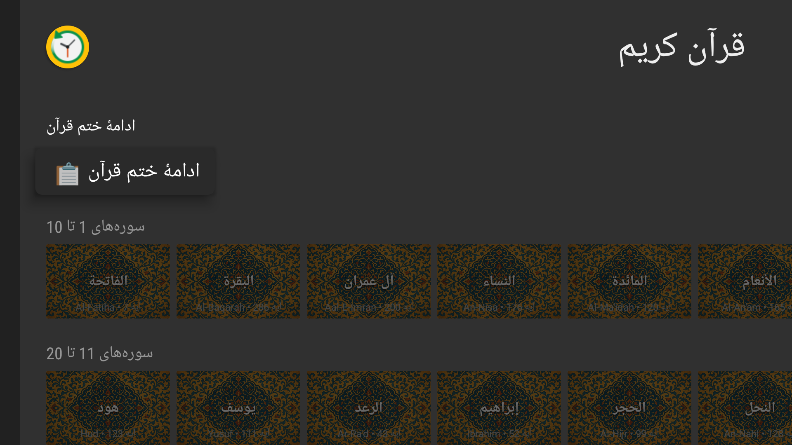
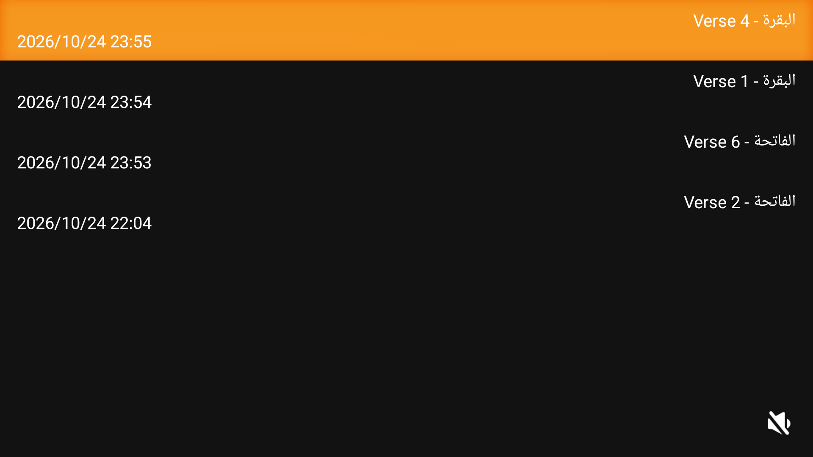
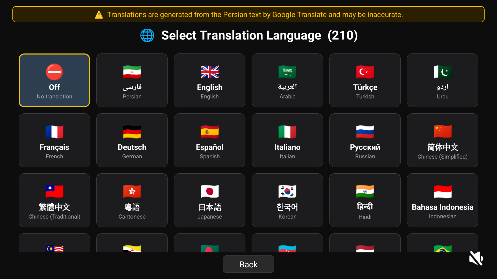
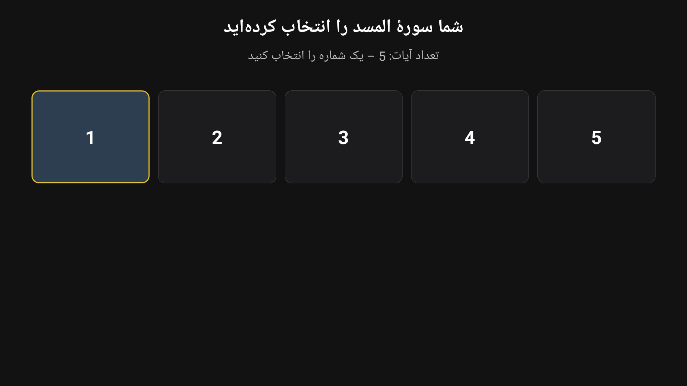
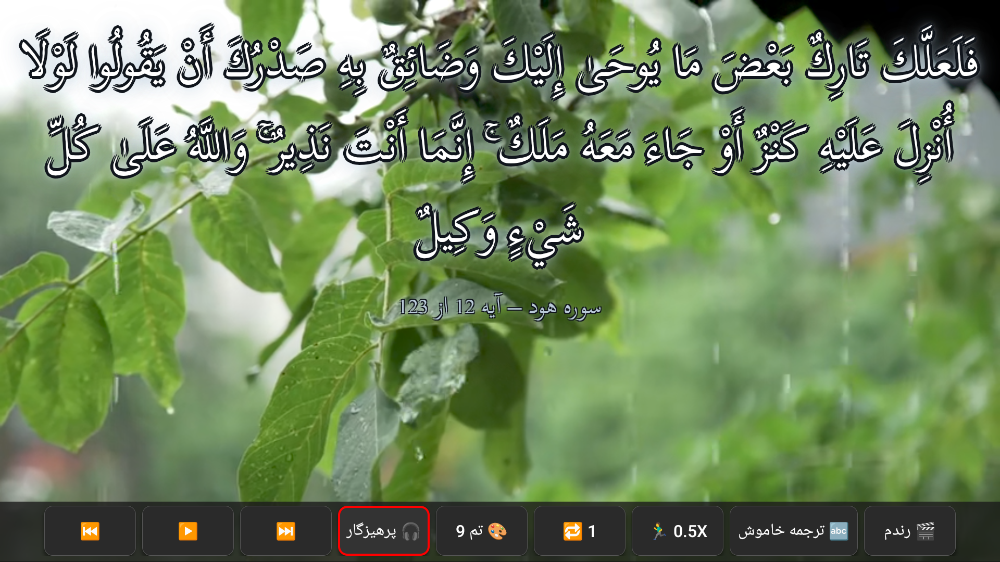

# Quran786TV

**Quran786TV** is a fork of [Arshad Quran TV](https://github.com/hatefali128-tech/Arshad_Quran_Android_TV), rebuilt and enhanced for Android TV.

## Features

- High-quality Quran verses playback
- **Multi-language translations in 210+ languages** powered by Google Translate
- TV-optimized UI with remote control navigation
- Fast and smooth browsing between surahs
- Lightweight and easy to install

## About This Fork

This project is based on the original **Arshad Quran TV** Android application. Quran786TV adds:

- Extended translation support for **210+ languages** via Google Translate
- Improved UI/UX for large TV screens
- Additional translation server selection options
- Better performance and stability

## Installation

Download the APK from the [Releases](../../releases) page and install it on your Android TV device.

## Screenshots

## Download

- [Cafe Bazaar](https://cafebazaar.ir/app/ir.fena.arshadqurantv_arshad_quran_tv)
- [Myket](https://myket.ir/app/ir.fena.arshadqurantv_arshad_quran_tv)

## Website

[quran.1fe.ir](https://quran.1fe.ir/)

## License

No official license. Free to use; all moral rights reserved by the developer.

---

If you find this project useful, please give it a star!
